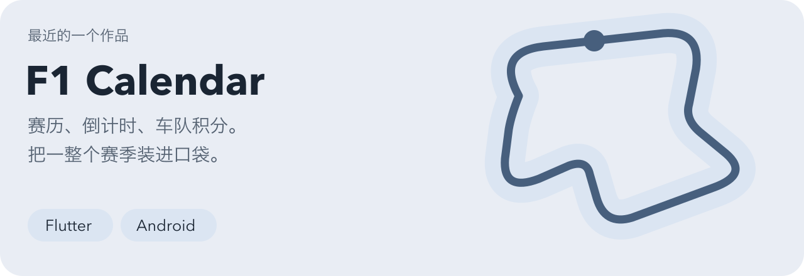
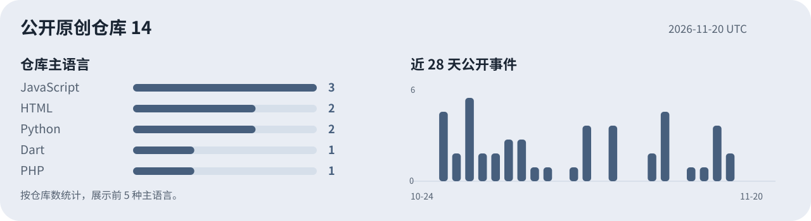

<!-- Design: M3 Expressive inspired. Muted blue tonal palette, purposeful shapes, real project / video content. -->
<picture>
  <source media="(prefers-color-scheme: dark) and (max-width: 600px)" srcset="assets/hero-mobile-dark.svg">
  <source media="(prefers-color-scheme: dark)" srcset="assets/hero-dark.svg">
  <source media="(max-width: 600px)" srcset="assets/hero-mobile.svg">
  
</picture>

  <a href="https://github.com/lzy3090Ti?tab=repositories"><picture><source media="(prefers-color-scheme: dark)" srcset="assets/github-link-dark.svg"></picture></a>
  <a href="https://space.bilibili.com/1785338201"><picture><source media="(prefers-color-scheme: dark)" srcset="assets/bilibili-link-dark.svg"></picture></a>

### 你好，我是 lzy3090Ti。

在 B 站叫 **「硬盒子和软盒子」**。还是个学生，平时写代码，也折腾硬件、拍科技视频。

从课堂上的随机点名，到装在手机里的 F1 赛历，我喜欢从身边的小需求开始做东西。这里放代码，视频里聊过程。

 

## 最近在做

<a href="https://github.com/lzy3090Ti/f1-calendar-flutter"><picture><source media="(prefers-color-scheme: dark)" srcset="assets/project-f1-dark.svg"></picture></a>

**[F1 Calendar](https://github.com/lzy3090Ti/f1-calendar-flutter)** · Flutter / Dart / Android 
整季赛历、周末日程和车队积分，已缓存的数据离线也能看。

还有几个正在折腾的项目：

- **[姿态感应视频](https://github.com/lzy3090Ti/roll-video-fullscreen-demo)** · 转动设备，让视频卡片跟着旋转、放大，进入全屏。
- **[Ai · 健康](https://github.com/lzy3090Ti/ai-health)** · 用 React、TypeScript 和 Capacitor 做个人健康档案与指标看板。
- **[随机点名](https://github.com/lzy3090Ti/random)** · 给课堂做的小工具，支持自定义名单，也有 Python 版本。

[查看所有项目](https://github.com/lzy3090Ti?tab=repositories)

 

## 视频里见

<a href="https://space.bilibili.com/1785338201"><picture><source media="(prefers-color-scheme: dark)" srcset="assets/channel-dark.svg"></picture></a>

  
  
  

[蜘蛛侠查找器](https://www.bilibili.com/video/BV1pTGc66Ecf/) · [小爱同学智能灯](https://www.bilibili.com/video/BV1TZGe61EfQ/) · [随机点名工具](https://www.bilibili.com/video/BV1USRvYZEvr/)

做出来的东西，也想拍给你看。完整视频和其他投稿都在 **[我的 B 站频道](https://space.bilibili.com/1785338201)**。

 

## GitHub 动态

<picture>
  <source media="(prefers-color-scheme: dark) and (max-width: 600px)" srcset="assets/activity-mobile-dark.svg">
  <source media="(prefers-color-scheme: dark)" srcset="assets/activity-dark.svg">
  <source media="(max-width: 600px)" srcset="assets/activity-mobile.svg">
  
</picture>

每天从 GitHub 官方 API 更新。主语言按公开原创仓库数统计；活动为公开事件数，不等于提交数，受 API 最近 300 条记录上限影响。[数据](assets/github-data.json) · [更新记录](https://github.com/lzy3090Ti/lzy3090Ti/actions/workflows/refresh-profile.yml)

 

<picture><source media="(prefers-color-scheme: dark)" srcset="assets/footer-dark.svg"></picture>
